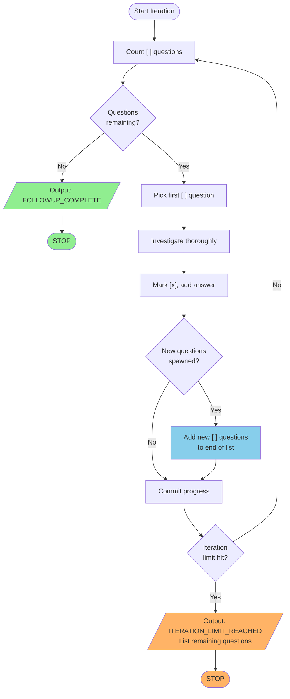

# RALPH_PROMPT.md - Self-Questioning Exploration Loop

## Core Loop Behavior

This is a **self-questioning loop**. You generate your own questions, answer them, and generate more questions from those answers. The loop continues until:
1. **Stop condition**: No unanswered questions remain, OR
2. **Iteration limit**: You've exhausted your allocated iterations

**Key principle**: Every answer should either resolve completely OR spawn new questions. The question list grows and shrinks dynamically as you explore.



## Your Task EVERY Iteration

### Step 1: Assess Current State
```bash
# Count unanswered questions
grep -c "\[ \]" investigation-answers.md

# If 0 unanswered questions exist, output completion signal and STOP
```

### Step 2: Pick Next Question
- Find the first question marked `[ ]` in `investigation-answers.md`
- If none exist, you are DONE (output completion signal)

### Step 3: Investigate Thoroughly
- Use code inspection, commands, documentation, web search
- Dig deep - surface-level answers spawn more questions

### Step 4: Document Your Answer
- Mark the question `[x]`
- Add detailed answer with evidence

### Step 5: CRITICAL - Generate New Questions
**This is what makes the loop self-sustaining:**
- Did your investigation reveal unknowns? → Add question
- Did you make an assumption that needs verification? → Add question
- Did you find a related problem? → Add question
- Did you discover an edge case? → Add question

**Add new questions to the end of the "New Questions Discovered" section with `[ ]` markers.**

### Step 6: Commit and Continue
```bash
git add investigation-answers.md
git commit -m "Follow-up: [brief summary]"
```

### Step 7: Loop Decision
- If unanswered questions remain (`[ ]` markers exist) → **Continue to Step 1**
- If no unanswered questions remain → **Output completion signal and STOP**

## Question Format in investigation-answers.md

```markdown
### New Questions Discovered

1. [ ] Should we create a `CSRFConfigurationException` for CSRF setup errors?
   <!-- UNANSWERED - pick this one next -->

2. [x] Should `Widget` be marked `@template-covariant`?

   **Answer:** Yes, because Widget only reads field data for display...

   **New questions raised:**
   - None

3. [ ] What exception hierarchy should we use for validation errors?
   <!-- This question was SPAWNED by investigating question 2 -->
```

**Important**: New questions go at the END of the list. Answer questions in order (first `[ ]` you find).

## Investigation Depth

For each question, aim for:

1. **Concrete Answer**: Yes/No/It depends, with clear reasoning
2. **Evidence**: Code examples, documentation links, or command output
3. **Trade-offs**: If applicable, what are the pros/cons
4. **Recommendation**: What should we do and why
5. **Spawned Questions**: Any new questions this investigation raised

## Self-Questioning Rules

### MUST Add New Questions When:
- Your answer includes "we need to decide..." → Add decision question
- Your answer includes "this assumes..." → Add verification question
- Your answer mentions "related to..." → Add exploration question
- Your answer has "edge case:" → Add edge case question
- You made a choice between alternatives → Add "why not X?" question
- You discovered something unexpected → Add "what about Y?" question

### Question Spawning Examples:
| Your Finding | Spawned Question |
|--------------|------------------|
| "We should use X instead of Y" | "What are the trade-offs of X vs Y?" |
| "This works for A" | "Does this also work for B and C?" |
| "PHP 7.4 doesn't support X" | "What's the best workaround for missing X?" |
| "PHPStan handles this" | "Does Psalm handle it the same way?" |

### Stop Adding Questions When:
- The question is purely implementation detail (save for implementation phase)
- The question is already answered elsewhere in the document
- The question is outside the scope of typing/static analysis
- The question would require external stakeholder input

### Convergence Strategy:
Questions should get progressively more specific. Broad questions spawn focused questions, which spawn concrete decisions, which resolve without spawning more.

## Useful Commands

### Code Inspection
```bash
# Search for patterns
grep -r "pattern" src/ --include="*.php"

# Find class usage
grep -rn "ClassName" src/

# Check method signatures
grep -A 5 "function methodName" src/path/to/file.php
```

### PHPStan/Psalm Testing
```bash
# Test a hypothesis
docker-compose -f .devcontainer/docker-compose.yml run --rm php74 vendor/bin/phpstan analyse src/path/to/file.php --memory-limit=512M

# Check if annotation works
echo '<?php /** @template-covariant T */ class Foo {}' | docker-compose -f .devcontainer/docker-compose.yml run --rm php74 vendor/bin/phpstan analyse --level=9 -
```

### Documentation Research
- PHPStan docs: https://phpstan.org/
- Psalm docs: https://psalm.dev/
- PHP RFC archive for language features

## Progress Tracking

After each question is answered:

```bash
git add investigation-answers.md
git commit -m "Follow-up: [brief summary of question answered]"
```

## Iteration Control

### Continue Loop If:
```
unanswered_count = count of "[ ]" markers in investigation-answers.md
if unanswered_count > 0:
    CONTINUE → go to Step 1
```

### Stop Loop If:
```
unanswered_count = count of "[ ]" markers in investigation-answers.md
if unanswered_count == 0:
    STOP → output completion signal
```

### Iteration Limit Behavior:
If you're approaching context/iteration limits:
1. Finish answering the current question
2. Commit your progress
3. Document remaining unanswered questions clearly
4. The next instance can pick up where you left off

## Completion Signal

**ONLY output this when ALL questions are answered (zero `[ ]` markers remain):**

<promise>FOLLOWUP_COMPLETE</promise>

**If stopping due to iteration limit with questions remaining, output:**

<promise>ITERATION_LIMIT_REACHED</promise>

Followed by:
```markdown
## Remaining Questions (for next iteration)
- [ ] Question 1 that still needs answering
- [ ] Question 2 that still needs answering
```

## Seed Questions (Initial List)

These are the **starting** questions from the initial investigation. The list will grow and shrink as you investigate:

1. Should we create a `CSRFConfigurationException` for CSRF setup errors?
2. Should `Widget` be marked `@template-covariant` since it only reads field data?
3. Should we add `@psalm-immutable` to option classes after construction?
4. How to handle i18n messages in a type-safe way (translation keys)?
5. Should we create a common `WTFormsException` base class?

**Note**: These are just the seed. Your investigations will likely spawn 10-50+ additional questions. That's expected and correct behavior.

## Quality Standards

**Good answer (drives loop toward completion):**
- Definitive recommendation with reasoning
- Code examples showing the approach
- Consideration of edge cases
- Clear "yes/no/it depends" conclusion
- **Spawns 0-2 focused follow-up questions** (or explicitly states "No new questions")

**Bad answer (stalls the loop):**
- "Maybe we should..." without deciding
- No concrete recommendation
- Missing evidence or examples
- Raises questions WITHOUT adding them to the question list
- Vague enough that the same question will need re-answering

**Self-Questioning Health Check:**
- If your last 3 answers spawned 0 questions → You might be answering too shallowly
- If your last 3 answers spawned 5+ questions each → You might be diverging; focus on convergence
- Healthy rate: ~1 new question per 2-3 answers as you near completion

## Context Refresh (Starting New Iteration)

If starting fresh after context reset or as a new instance:

```bash
# Step 1: Count remaining questions
REMAINING=$(grep -c "\[ \]" investigation-answers.md 2>/dev/null || echo "0")
echo "Unanswered questions: $REMAINING"

# Step 2: If 0, you're done!
if [ "$REMAINING" -eq "0" ]; then
    echo "All questions answered - output FOLLOWUP_COMPLETE"
    exit 0
fi

# Step 3: Find the first unanswered question
grep -n "\[ \]" investigation-answers.md | head -1

# Step 4: See recent progress for context
git log --oneline -5
```

## Start Your Loop Now

1. Run the context refresh commands above
2. If unanswered questions exist, pick the first one
3. Investigate, answer, spawn new questions
4. Commit and repeat

**Begin exploration immediately. Find the next `[ ]` question and investigate it.**
